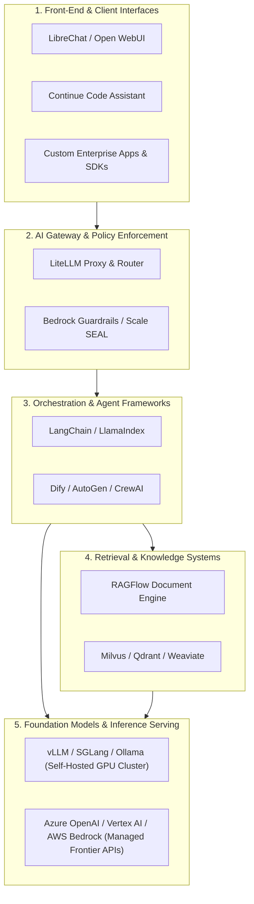

# 🌐 Awesome Enterprise Generative AI Services

**The Definitive Curated Ecosystem of Enterprise LLM Platforms, Managed Foundation Models, High-Throughput Inference Engines, Agent Frameworks & Sovereign Self-Hosted Stacks**

  
  
  
  
  
  

---

## 📖 Overview

Enterprise Generative Artificial Intelligence (GenAI) represents a foundational transformation in enterprise software architecture, automated reasoning, and organizational intelligence. This repository tracks prominent **enterprise SaaS platforms** and **open-source sovereign GitHub projects** engineered for enterprise-grade generative AI deployments.

Whether your team is designing mission-critical Retrieval-Augmented Generation (RAG) pipelines, orchestrating autonomous multi-agent swarms, serving open-weight models at scale with ultra-low latency, or provisioning sovereign on-premise AI infrastructure, this guide delivers factual technical insights, verified pricing tiers, and community metrics.

---

## 📑 Table of Contents

- [📊 Sector Overview & Market Dynamics](#-sector-overview--market-dynamics)
- [☁️ SaaS & Managed Enterprise Platforms](#️-saas--managed-enterprise-platforms)
- [🛠️ Open-Source GitHub Projects](#️-open-source-github-projects)
- [🏗️ Enterprise Architectural Blueprint](#️-enterprise-architectural-blueprint)
- [🤝 How to Contribute](#-how-to-contribute)
- [📈 Star History](#-star-history)
- [💖 Support & Community](#-support--community)
- [📜 Disclaimer & Licensing](#-disclaimer--licensing)

---

## 📊 Sector Overview & Market Dynamics

The global **Enterprise Generative AI market** is valued at approximately **$19.8 Billion in 2023 and is projected to surpass $120+ Billion by 2030–2032**, expanding at an aggressive compound annual growth rate (CAGR) of **~36.8%**.

From an industry structure perspective, the sector exhibits a **bifurcated market dynamic: high concentration at the foundational compute and frontier foundation model layer** (dominated by hyperscalers including Microsoft Azure, Google Cloud, and AWS alongside elite frontier labs such as OpenAI and Anthropic), **contrasted with dynamic, widespread fragmentation across application orchestration, data integration, developer tooling, and self-hosted inference runtimes**. While hyperscaler ecosystems capture significant enterprise spend through enterprise discount programs (EDPs) and zero-trust security compliance, enterprises increasingly implement multi-model hybrid topologies—leveraging open-source runtimes (vLLM, SGLang, Ollama) and vector databases (Milvus, Qdrant) to maintain data sovereignty, eliminate vendor lock-in, and optimize token unit economics.

---

## ☁️ SaaS & Managed Enterprise Platforms

The following table benchmarks category-leading enterprise SaaS and hyperscaler generative AI platforms, **sorted in descending order by company scale (market capitalization / enterprise valuation)**:

| Platform / Service | Enterprise Scale / Valuation | Key Offerings & Capabilities | Starting Pricing (Specific Tier) | Free Tier / Trial Limit |
| :--- | :--- | :--- | :--- | :--- |
| **[Microsoft Azure OpenAI Service](https://azure.microsoft.com/en-us/products/ai-services/openai-service)** | **~$3.12T Market Cap** *(FY24 Rev: $245.1B)* | Enterprise-grade managed GPT-4o, o1, and embeddings with Azure Private VNet integration, HIPAA/SOC 2 Type II compliance, and Microsoft Purview data governance. | **$0.150 / 1M input tokens, $0.600 / 1M output tokens** (GPT-4o-mini); Provisioned Throughput Units (PTU) starting from ~$1,200/month. | **$200 free Azure credit for 30 days** upon initial signup + 55+ services always-free. |
| **[Google Cloud Vertex AI](https://cloud.google.com/vertex-ai)** | **~$2.18T Market Cap** *(FY24 Rev: $307.4B)* | Unified enterprise AI/ML platform providing Gemini 1.5/2.0 multimodal models, Model Garden (130+ models), automated fine-tuning, and Google Search grounding. | **$0.075 / 1M input tokens, $0.300 / 1M output tokens** (Gemini 1.5 Flash text); Custom AutoML training starting at **$0.49 / node-hour**. | **$300 free credits for 90 days** for new GCP accounts + free rate-limited quota on Gemini models via Google AI Studio (up to 15 RPM / 1M TPM). |
| **[AWS Bedrock](https://aws.amazon.com/bedrock/)** | **~$1.98T Market Cap** *(FY24 Rev: $574.8B)* | Serverless unified API accessing foundation models from Anthropic (Claude 3.5), Meta (Llama 3), Mistral AI, Cohere, and Amazon Titan with Bedrock Guardrails. | **$0.200 / 1M input tokens, $0.600 / 1M output tokens** (Amazon Titan Text Express); Claude 3.5 Haiku at **$0.80 / 1M input, $4.00 / 1M output**. | **2-month free trial** on select foundation models + AWS Free Tier (12 months free access + up to $100 AWS Activate startup credits). |
| **[Adobe Sensei GenAI & Firefly](https://business.adobe.com/products/sensei/sensei-genai.html)** | **~$224B Market Cap** *(FY24 Rev: $21.4B)* | Enterprise content generation and marketing personalization embedded across Adobe Experience Cloud and Creative Cloud with commercial IP indemnification. | **$150 / user / month** (Adobe Firefly for Enterprise subscription tier) or customized enterprise master service agreements (MSAs). | **25 free monthly Generative Credits** on standard Adobe ID accounts; 14-day guided proof-of-concept trial for enterprise teams. |
| **[OpenAI Platform](https://platform.openai.com/)** | **$157B Valuation** *(ARR: $3.7B+)* | Frontier foundational intelligence (GPT-4o, o1 reasoning models, DALL·E 3, Whisper, TTS, Text Embeddings) with strict enterprise zero-data-retention agreements. | **$0.150 / 1M input tokens, $0.600 / 1M output tokens** (GPT-4o-mini); ChatGPT Team tier at **$25 / user / month** (billed annually) or **$30 / user / month** (monthly). | **$5.00 initial free API credit valid for 3 months** upon SMS verification; ChatGPT Free tier with rate-limited access to GPT-4o. |
| **[Anthropic Claude](https://www.anthropic.com/claude)** | **$40B Valuation** *(ARR: $1.0B+)* | Safety-aligned frontier models (Claude 3.5 Sonnet, Claude 3.5 Haiku, Claude 3 Opus) featuring 200K token context windows, Computer Use API, and prompt caching. | **$0.80 / 1M input tokens, $4.00 / 1M output tokens** (Claude 3.5 Haiku); Claude Team plan at **$30 / user / month** (minimum 5 seats). | **$5.00 initial free API credit** on Anthropic Console upon developer signup; Claude.ai Free tier with dynamic quotas resetting every 5 hours. |
| **[Scale AI](https://scale.com/)** | **$13.8B Valuation** *(ARR: $750M+)* | Enterprise GenAI data engine providing human-in-the-loop RLHF, synthetic data curation, automated LLM red-teaming, and model safety benchmarking (SEAL). | **$0.02 / task** (pay-as-you-go data labeling); Scale GenAI Platform base enterprise deployments starting at **$25,000 / year**. | **14-day free pilot access** with sample dataset ingestion credits upon enterprise sales evaluation. |
| **[Cohere](https://cohere.com/)** | **$5.5B Valuation** *(ARR: $50M+)* | Enterprise-native multilingual LLMs (Command R, Command R+), industry-standard Rerank 3 models, and high-density Embed v3 for private VPC and on-premise RAG. | **$0.150 / 1M input tokens, $0.600 / 1M output tokens** (Command R); Embed v3 at **$0.10 / 1M tokens**; Rerank at **$1.00 / 1K search queries**. | **Free Trial Developer Key with 1,000 free API requests / month** (rate-limited at 10–20 RPM) for prototyping and non-commercial development. |
| **[Writer](https://writer.com/)** | **$1.9B Valuation** *(ARR: $35M+)* | Full-stack generative AI platform powered by Palmyra models, enterprise Knowledge Graph RAG, and autonomous workflow agent builder for business teams. | **$18 / user / month** (billed monthly) or **$15 / user / month** (billed annually) for Team tier (up to 5 seats); custom enterprise pricing for dedicated models. | **14-day free trial** on Team tier with complete access to Writer generative studio and up to 5 user seats. |
| **[Jasper AI](https://www.jasper.ai/)** | **$1.5B Valuation** *(ARR: $90M+)* | Enterprise generative marketing copilot with multi-brand voice management, campaign workflows, style guides, and automated cross-channel content generation. | **$49 / month** (billed monthly) or **$39 / month** (billed annually) for Creator tier (1 seat); Pro tier at **$69 / month** ($59/mo annual) for up to 6 seats. | **7-day free trial** with 10,000 generated words and access to standard marketing templates and brand voices. |

---

## 🛠️ Open-Source GitHub Projects

Open-source and open-weight architectures give organizations full data sovereignty, zero egress expenses, zero IP lock-in, and customizable fine-tuning. The following projects are **sorted in descending order by GitHub stargazers**, with direct links to each repository's stargazers community:

1. **[AutoGPT](https://github.com/Significant-Gravitas/AutoGPT)**   
   *Pioneering autonomous AI agent platform designed for building, testing, and deploying continuous multi-step agentic workflows and tool execution.*

2. **[Ollama](https://github.com/ollama/ollama)**   
   *Lightweight, high-performance runtime to get up and running with open-weight LLMs (Llama 3, DeepSeek, Qwen 2.5, Gemma 2, Mistral) locally and across enterprise clusters with an OpenAI-compatible REST API.*

3. **[Dify](https://github.com/langgenius/dify)**   
   *Production-grade LLM application development platform featuring a visual workflow canvas, enterprise RAG pipeline, multi-agent orchestration, and native observability.*

4. **[Open WebUI](https://github.com/open-webui/open-webui)**   
   *Feature-rich, self-hosted web interface supporting Ollama, OpenAI-compatible APIs, enterprise RBAC authentication, document RAG, and custom modelfiles.*

5. **[LangChain](https://github.com/langchain-ai/langchain)**   
   *The de facto enterprise agent engineering platform and composable framework for building context-aware reasoning applications, chains, tool connections, and multi-agent systems.*

6. **[ComfyUI](https://github.com/comfyanonymous/ComfyUI)**   
   *The most modular and powerful node-based graphical interface and API backend for diffusion-based image, video, audio, and 3D generative pipelines.*

7. **[vLLM](https://github.com/vllm-project/vllm)**   
   *Industrial-strength, memory-efficient inference and model serving engine powered by PagedAttention, continuous batching, and chunked prefill for maximum GPU utilization.*

8. **[RAGFlow](https://github.com/infiniflow/ragflow)**   
   *Next-generation open-source Retrieval-Augmented Generation engine based on deep document understanding, template extraction, and hybrid search across complex enterprise data formats.*

9. **[LiteLLM](https://github.com/BerriAI/litellm)**   
   *Ultra-fast enterprise AI proxy gateway. Call 100+ LLM APIs in the OpenAI format with unified billing, load balancing, rate limiting, and fallbacks.*

10. **[AutoGen](https://github.com/microsoft/autogen)**   
    *Microsoft's multi-agent conversation framework enabling autonomous collaboration between specialized conversational agents with human-in-the-loop capabilities.*

11. **[CrewAI](https://github.com/crewAIInc/crewAI)**   
    *Intuitive framework for orchestrating role-playing autonomous AI agents into collaborative crews to automate complex, multi-stage enterprise tasks.*

12. **[Flowise](https://github.com/FlowiseAI/Flowise)**   
    *Drag-and-drop low-code user interface for visually constructing LLM orchestration flows, RAG pipelines, and conversational agents.*

13. **[LlamaIndex](https://github.com/run-llama/llama_index)**   
    *Leading data framework for connecting private enterprise data sources (SQL, APIs, PDFs, Notion) to LLMs with advanced retrieval algorithms, indexing, and synthesis.*

14. **[LocalAI](https://github.com/mudler/LocalAI)**   
    *Self-hosted, drop-in OpenAI-compatible alternative for running LLMs, image generation, audio, and embeddings locally on consumer and enterprise hardware without GPU requirements.*

15. **[Text Generation WebUI](https://github.com/oobabooga/text-generation-webui)**   
    *Extensive local LLM interface supporting multiple backend loaders (Transformers, llama.cpp, ExLlamaV2), multimodal vision models, LoRA fine-tuning, and extensions.*

16. **[Milvus](https://github.com/milvus-io/milvus)**   
    *High-performance, distributed, cloud-native vector database built for massive-scale similarity search and billion-scale enterprise RAG indexing.*

17. **[LibreChat](https://github.com/danny-avila/LibreChat)**   
    *Omnichannel enterprise chat system providing an enhanced ChatGPT-like UI supporting Anthropic, OpenAI, AWS Bedrock, Google Vertex, Ollama, Model Context Protocol (MCP), and Code Interpreter.*

18. **[SGLang](https://github.com/sgl-project/sglang)**   
    *High-throughput structured execution and serving engine for LLMs and vision-language models with RadixAttention for blazing-fast multi-turn prefix caching.*

19. **[Continue](https://github.com/continuedev/continue)**   
    *Open-source AI code assistant extension for VS Code and JetBrains IDEs allowing developers to bring any self-hosted or proprietary commercial model directly into their development flow.*

20. **[Qdrant](https://github.com/qdrant/qdrant)**   
    *Production vector similarity search engine written in Rust with extended payload filtering, quantization, and high hardware efficiency for real-time RAG applications.*

21. **[Chroma](https://github.com/chroma-core/chroma)**   
    *AI-native open-source embedding database designed for Python and JavaScript developers to rapidly build semantic search and retrieval applications.*

22. **[Haystack](https://github.com/deepset-ai/haystack)**   
    *Production-ready Python LLM orchestration framework by deepset for building modular search systems, conversational agents, and complex RAG pipelines.*

23. **[Weaviate](https://github.com/weaviate/weaviate)**   
    *Cloud-native open-source vector database combining vector search, hybrid sparse-dense retrieval, and built-in generative search modules.*

24. **[AI Toolkit](https://github.com/ostris/ai-toolkit)**   
    *Comprehensive training suite for fine-tuning text-to-image and diffusion models using LoRA and LoKr techniques with full Docker support.*

25. **[Petals](https://github.com/bigscience-workshop/petals)**   
    *Decentralized, collaborative BitTorrent-style network for running 70B+ LLM inference and fine-tuning by distributing transformer layers across peer nodes.*

26. **[Xinference](https://github.com/xorbitsai/inference)**   
    *Unified cluster serving library enabling one-command deployment of LLMs, speech recognition, and multimodal vision models across distributed hardware.*

27. **[Argilla](https://github.com/argilla-io/argilla)**   
    *Data-centric AI collaboration platform for engineers and domain experts to annotate, curate, and refine high-quality datasets for LLM instruction-tuning and RLHF.*

---

## 🏗️ Enterprise Architectural Blueprint

For enterprise platform teams architecting a resilient, hybrid Generative AI stack, the recommended reference pattern integrates self-hosted open-source components with commercial frontier APIs:

---

## 🤝 How to Contribute

Contributions from the AI engineering, research, and enterprise developer communities are warmly welcomed! 🚀

1. 🍴 **Fork the repository** to your personal GitHub account.
2. 🌿 **Create a feature branch** (`git checkout -b feature/add-new-genai-service`).
3. 📝 **Add or update entries** in `README.md` maintaining consistent markdown formatting:
   - **For SaaS additions**: Include verified starting tier prices, enterprise valuation / scale, and specific free trial / tier limits.
   - **For Open-Source additions**: Include the shields.io social star badge linking to the repository stargazers page.
4. ✅ **Ensure accuracy** with factual descriptions and links to official documentation.
5. 📤 **Submit a Pull Request** with a concise description of why the tool belongs in this enterprise directory.

---

##  Star History

---

## 💖 Support & Community

Thank you for exploring and bookmarking **Awesome Enterprise Generative AI Services**! ⭐

If you find this curated directory valuable for your enterprise architecture, research, or development projects, please consider supporting the project:
- ⭐ **Star** this repository on GitHub to boost its visibility for the global AI community.
- 🍴 **Fork** and contribute new tools, performance benchmarks, and ecosystem updates.
- 📢 **Share** this resource with colleagues, engineering leads, and on LinkedIn / Twitter.
- ☕ **Support the maintainer** or buy a coffee via the [GitHub Sponsor Dashboard](https://github.com/sponsors/ishandutta2007) to help sustain ongoing research and curation.

  

---

## 📜 Disclaimer & Licensing

- **Community Curated**: This repository is community-curated for informational, architectural, and educational purposes. Mentions do not constitute commercial endorsement.
- **Enterprise Compliance**: Deployment of generative AI services must comply with regulatory requirements, organizational data privacy policies, and intellectual property governance.
- **Licensing**: This repository is licensed under the [MIT License](LICENSE). Please review individual commercial terms and open-weight licensing constraints (e.g., Apache 2.0 vs Llama Community License) for each respective service.

---

  Curated with ❤️ by <a href="https://github.com/ishandutta2007">Ishan Dutta</a> and the Global Generative AI Community.

